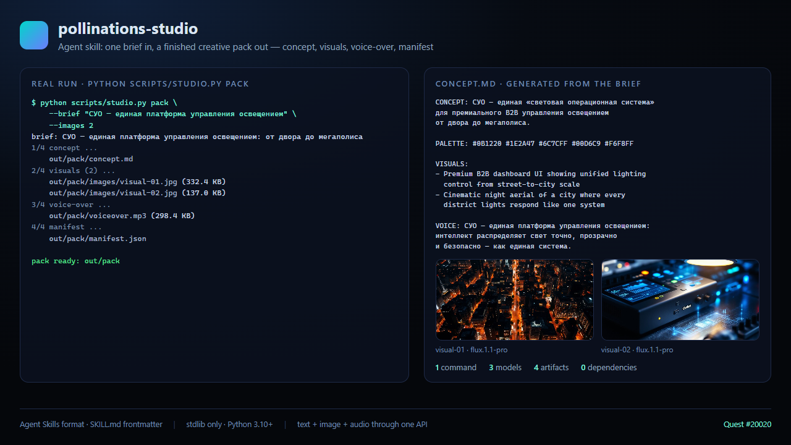

# Pollinations Studio

[](https://pollinations.ai/?ref=badge)



An [Agent Skill](https://agentskills.io) that turns a one-line brief into a
finished creative package — a written direction, key visuals, a voice-over and a
manifest — using Pollinations text, image and audio models.

Ask an agent for "a brand concept for an industrial power platform" and get back:

```
out/pack/
  concept.md          CONCEPT / PALETTE / VISUALS / VOICE
  images/visual-01.jpg visual-02.jpg visual-03.jpg
  voice-script.txt
  voiceover.mp3
  manifest.json
```

No SDK, no build step, no dependencies: `scripts/studio.py` is standard library
Python 3.10+.

## Why another media skill

Most image skills hard-code one provider and one model. This one treats the
creative brief as the input and the model catalogue as a variable: it reads the
live Pollinations model list (categories, prices, `paid_only` flags) and picks a
sensible default per task, so the same skill works on a free balance and on a
paid one.

## Install

```bash
git clone <your-fork-url> pollinations-studio
cd pollinations-studio
export POLLINATIONS_API_KEY=sk_...        # https://enter.pollinations.ai/keys
```

Windows PowerShell:

```powershell
$env:POLLINATIONS_API_KEY = "sk_..."
```

Place the directory where your agent looks for skills (for Claude Code and
similar: `~/.claude/skills/pollinations-studio`). `SKILL.md` carries the
frontmatter the format requires.

## Authentication

**No key to paste.** Sign in once with the device flow:

```bash
python scripts/studio.py login
```

The script prints a code and the address `https://enter.pollinations.ai/device`,
waits for your approval, then stores the token in
`~/.config/pollinations/credentials.json` (mode 600). Every later command uses it
silently. `python scripts/studio.py logout` removes it.

The login uses the public App Key of this skill as the OAuth client id
(`pk_YxXyBK7lNdUC9mYf`, publishable by design — it carries no secret). Users
always spend from their own Pollinations balance; nothing is billed to the skill.

For automation (CI, servers) the environment variable stays supported:

```bash
export POLLINATIONS_API_KEY=sk_...   # optional, takes precedence over the stored token
```

For web apps, use the
[`polli-connect`](https://github.com/pollinations/pollinations/blob/main/BRING_YOUR_OWN_POLLEN.md)
element: it runs the same OAuth flow in the browser and exposes the user's own
key to your page. App Key, redirect URIs and earnings are described there too.
## Use

```bash
# catalogue with prices
python scripts/studio.py models --category image
python scripts/studio.py models --category audio --free-only

# creative direction
python scripts/studio.py concept --brief "premium electricity brand for industrial parks"

# one image
python scripts/studio.py image \
  --prompt "editorial brand tile, interlocking circles emblem, graphite and cyan" \
  --model black-forest-labs/flux.1.1-pro --size 1024x1024 --out out/images

# narration
python scripts/studio.py voice --text "Русский свет интеграция." --voice nova

# the whole pack
python scripts/studio.py pack --brief "brand concept for an industrial power platform" --images 3
```

### Commands

| Command | What it does | Key flags |
|---|---|---|
| `models` | lists models with category, `paid_only` and pricing | `--category`, `--free-only` |
| `concept` | writes CONCEPT / PALETTE / VISUALS / VOICE blocks | `--brief`, `--model`, `--out` |
| `image` | generates one or more images | `--prompt`, `--model`, `--size`, `--count`, `--seed`, `--out`, `--json` |
| `voice` | text to speech | `--text`/`--file`, `--model`, `--voice`, `--out` |
| `pack` | concept → visuals → voice-over → manifest | `--brief`, `--images`, `--size`, `--no-voice`, `--out` |
| `login` | sign in with Pollinations, no key to paste | `--force` |
| `logout` | forget the stored token | — |

Every command prints the paths it wrote, so agents can chain steps without
parsing JSON. `image --json` also emits machine-readable paths.

## Defaults

| Job | Model | Why |
|---|---|---|
| Creative direction | `openai/gpt-5.4-nano` | fast, cheap, good structure |
| Visuals | `black-forest-labs/flux.1.1-pro` | the best finished-look image model in the catalogue |
| Drafts | `black-forest-labs/flux.1-schnell` (alias `flux`) | quick iteration |
| Narration | `openai/tts-1` | six voices, low cost |

Override any of them with flags; `models` shows what else exists.

## How it works

`studio.py` is four thin wrappers over one API base (`https://gen.pollinations.ai/v1`):

- `GET /models` → catalogue
- `POST /chat/completions` → concept text
- `POST /images/generations` → `b64_json` decoded straight to disk
- `POST /audio/speech` → MP3 bytes written to disk

Requests retry on transient failures, and error bodies are surfaced verbatim —
`401` bad key, `402` empty balance, `400` wrong endpoint for the model.

## Notes from building it

- Image models follow English prompts noticeably better than Russian ones, while
  the written concept should stay in the brief's language.
- `flux` is an alias for `flux.1-schnell`; use `flux.1.1-pro` when the output is
  going in front of a client.
- Always look at the generated image before shipping: models invent lettering and
  occasionally ignore the subject.

## License

### Update — repository populated

- Code: https://github.com/kalif3223-glitch/pollinations-studio/blob/main/scripts/studio.py
  (stdlib CLI calling /chat/completions, /images/generations, /audio/speech)
- README with badge, usage and the "Made with pollinations.ai" credit:
  https://github.com/kalif3223-glitch/pollinations-studio#readme
- Authentication: POLLINATIONS_API_KEY (server-side key) or polli-connect
  sign-in for web UIs — documented in README → Authentication
- Default model IDs: black-forest-labs/flux.1.1-pro (images),
  openai/gpt-5.4-nano (text), openai/tts-1 (audio) — all paid_only=false
- Demo screenshot from a real run: docs/demo.png

  
MIT — see [LICENSE](LICENSE).


